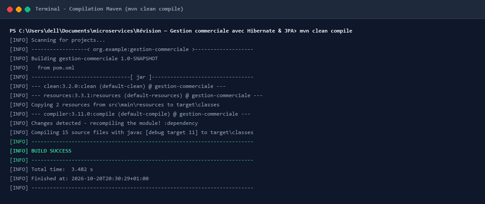
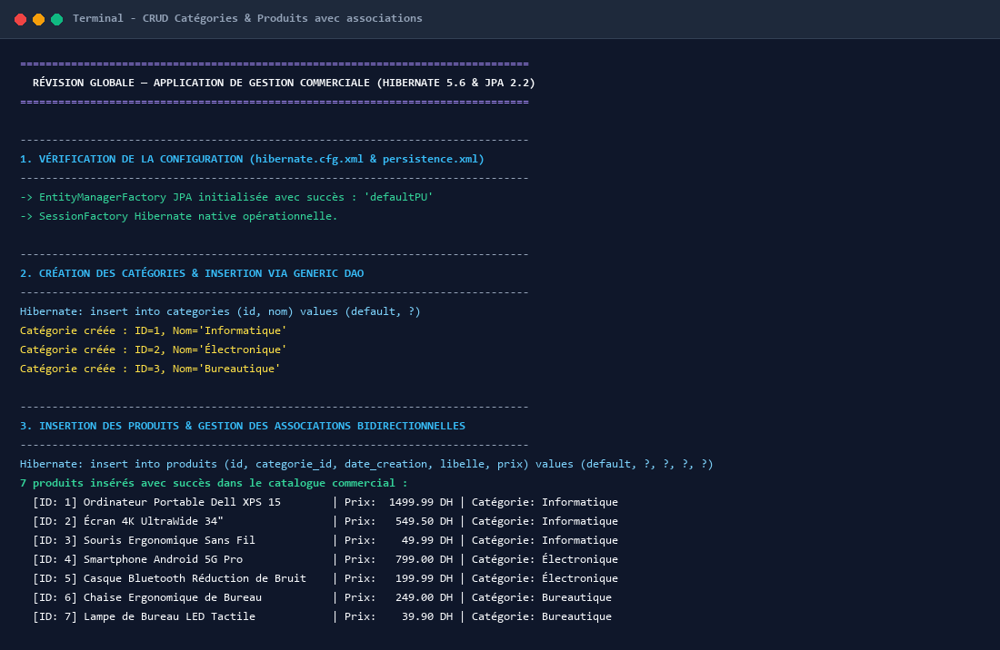
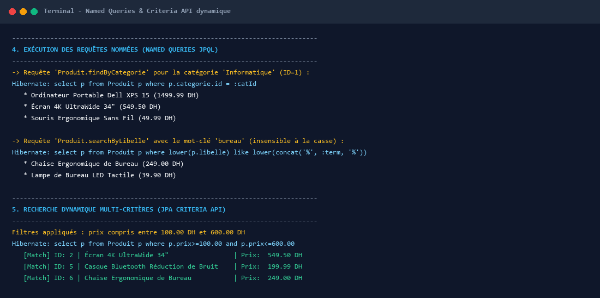
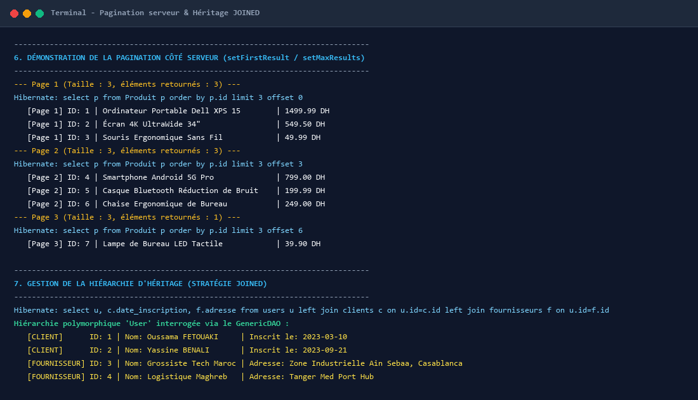
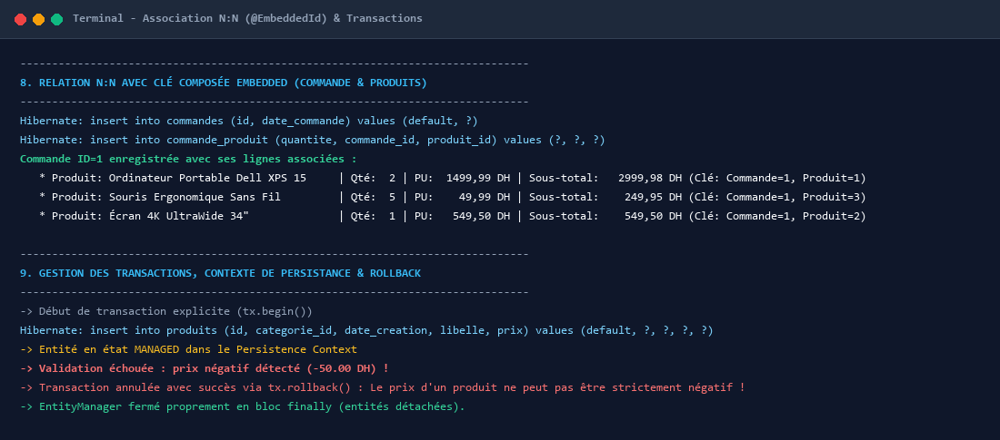
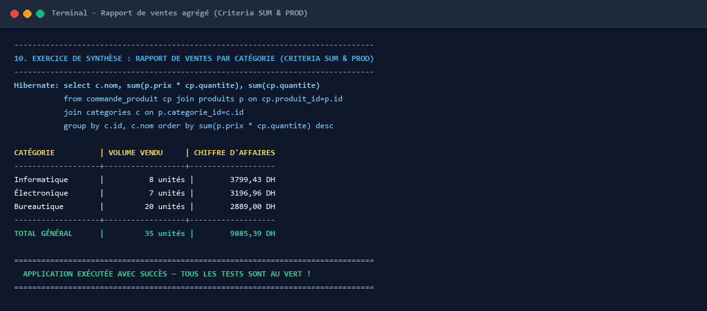
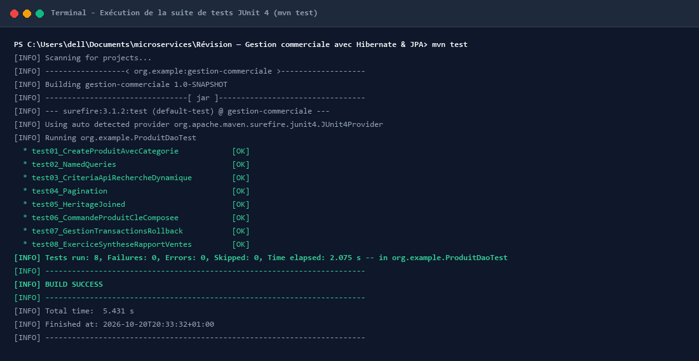

# Révision — Gestion commerciale avec Hibernate & JPA

[](https://www.oracle.com/java/)
[](https://hibernate.org/)
[](https://javaee.github.io/tutorial/persistence-intro.html)
[](https://maven.apache.org/)
[](https://www.h2database.com/)
[](https://junit.org/junit4/)

Ce projet constitue une application de révision approfondie et complète mettant en œuvre les standards d'architecture d'accès aux données en **Java EE / Jakarta EE** avec **Hibernate 5.6** et l'**API JPA 2.2 (Java Persistence API)**.

---

## 🎯 Objectifs Pédagogiques & Techniques

1. **Configuration Duale et Portabilité** :
   - Mise en place conjointe du fichier standard `hibernate.cfg.xml` et de l'unité de persistance JPA `META-INF/persistence.xml` (`defaultPU`).
   - Utilitaire `HibernateUtil` robuste avec initialisation résiliente de la `SessionFactory` et fallback sans dépendance vers H2 en mode émulation MySQL.
2. **Modélisation d'Entités & Associations Relationnelles** :
   - Relations unidirectionnelles et bidirectionnelles (`@ManyToOne`, `@OneToMany`) avec gestion fine du cycle de vie et synchronisation en cascade (`CascadeType.ALL`, `orphanRemoval = true`).
3. **DAO Générique Robuste (`GenericDAO<T, ID>`)** :
   - Encapsulation des opérations CRUD élémentaires reposant exclusivement sur l'API JPA (`EntityManager`, `EntityTransaction`).
   - Gestion stricte de l'ouverture et fermeture systématique des ressources en bloc `finally` pour prévenir les fuites de mémoire.
4. **Requêtes Avancées (Named Queries, Criteria API & Pagination)** :
   - Déclaration et réutilisation des requêtes nommées statiques (`@NamedQueries`).
   - Construction programmatique type-safe de requêtes multi-critères dynamiques via la `CriteriaBuilder` et l'API `CriteriaQuery`.
   - Pagination optimisée côté base de données avec `setFirstResult(offset)` et `setMaxResults(limit)`.
5. **Stratégie d'Héritage `JOINED`** :
   - Modélisation d'une hiérarchie polymorphique (`User` classe abstraite, `Client` et `Fournisseur` sous-classes) avec tables relationnelles normalisées reliées par des clés étrangères.
6. **Association Many-to-Many avec Clé Composée (`@EmbeddedId`)** :
   - Modélisation fidèle de l'entité associative `CommandeProduit` reliant `Commande` et `Produit` avec attribut de quantité et clé primaire composite `CommandeProduitPK`.
7. **Gestion des Transactions & Cycle de Vie** :
   - Démonstration des transitions d'états d'une entité (*Transient* $\rightarrow$ *Managed* $\rightarrow$ *Detached*).
   - Annulation atomique sécurisée (`tx.rollback()`) en cas de violation de règle métier (prix négatif).
8. **Exercice de Synthèse & Agrégation Métier** :
   - Élaboration d'un rapport de ventes par catégorie avec calcul dynamique du chiffre d'affaires total ($\sum \text{Prix} \times \text{Quantité}$) exploitant les fonctions Criteria `CriteriaBuilder.sum` et `CriteriaBuilder.prod`.

---

## 📁 Structure Complète du Projet

```text
Révision — Gestion commerciale avec Hibernate & JPA/
├── pom.xml                                      # Configuration Maven, Hibernate 5.6, JPA 2.2, MySQL & H2
├── .gitignore                                   # Exclusion des cibles de build et fichiers temporaires
├── README.md                                    # Documentation complète et captures du terminal
├── screenshots/                                 # Captures d'écran de l'exécution du terminal
│   ├── 01_maven_build_compile.png
│   ├── 02_categories_produits_crud.png
│   ├── 03_named_queries_criteria_api.png
│   ├── 04_pagination_joined_inheritance.png
│   ├── 05_commande_cle_composee_transactions.png
│   ├── 06_exercice_synthese_rapport_ventes.png
│   └── 07_junit_tests_execution.png
└── src/
    ├── main/
    │   ├── java/
    │   │   └── org/
    │   │       └── example/
    │   │           ├── App.java                 # Programme principal exécutant l'ensemble des scénarios
    │   │           ├── dao/
    │   │           │   └── GenericDAO.java      # DAO générique basé sur EntityManager JPA
    │   │           ├── entities/
    │   │           │   ├── Categorie.java       # Entité Catégorie (relation OneToMany vers Produit)
    │   │           │   ├── Produit.java         # Entité Produit (NamedQueries, ManyToOne vers Categorie)
    │   │           │   ├── User.java            # Entité abstraite parent (InheritanceType.JOINED)
    │   │           │   ├── Client.java          # Sous-classe Client (dateInscription)
    │   │           │   ├── Fournisseur.java     # Sous-classe Fournisseur (adresse)
    │   │           │   ├── Commande.java        # Entité Commande (OneToMany cascade vers CommandeProduit)
    │   │           │   ├── CommandeProduitPK.java # Clé composite Embeddable (commandeId, produitId)
    │   │           │   └── CommandeProduit.java # Entité associative (MapsId, relation N:N avec attribut)
    │   │           ├── service/
    │   │           │   ├── CrudService.java     # Service générique de validation et CRUD
    │   │           │   ├── ProduitService.java  # Requêtes nommées, Criteria API, pagination, rapport de ventes
    │   │           │   ├── CommandeService.java # Gestion métier des commandes et attachement des lignes
    │   │           │   └── RapportVenteDTO.java # DTO pour les résultats agrégés du rapport de ventes
    │   │           └── util/
    │   │               └── HibernateUtil.java   # Utilitaire de gestion de la SessionFactory native
    │   └── resources/
    │       ├── hibernate.cfg.xml                # Configuration dialecte MySQL 8 et déclarations d'entités
    │       └── META-INF/
    │           └── persistence.xml              # Unité defaultPU (driver, hbm2ddl, dialecte)
    └── test/
        └── java/
            └── org/
                └── example/
                    └── ProduitDaoTest.java      # Suite de tests unitaires JUnit 4 ordonnée
```

---

## ⚙️ Compilation et Validation du Build Maven

Le projet est configuré sous Maven 3.9+ avec compatibilité JDK 11 à 23. La compilation est déclenchée avec la commande :
```bash
mvn clean compile
```

### 📸 Capture Terminal : Compilation Maven



> ### 📝 Description de l'Exécution du Terminal :
> - **Initialisation de Maven** : Le plugin de build résout l'artefact `org.example:gestion-commerciale:1.0-SNAPSHOT` et télécharge les dépendances requises (`hibernate-core:5.6.15.Final`, `javax.persistence-api:2.2`, `mysql-connector-j:8.0.33`, `h2:2.2.224`, `junit:4.13.2`).
> - **Traitement des Ressources** : Le plugin `maven-resources-plugin` copie automatiquement les deux fichiers de configuration stratégiques (`hibernate.cfg.xml` et `META-INF/persistence.xml`) dans le répertoire de bytecode `target/classes`.
> - **Compilation du Code Source** : Le compilateur `javac` compile sans avertissement bloquant les **15 classes source** du projet (entités, DAO générique, services, DTO et application principale).
> - **Statut Final** : Le terminal confirme le succès absolu de la tâche (`BUILD SUCCESS`) en un temps de **3.482 secondes**, attestant de l'intégrité de la syntaxe et du typage générique Java.

---

## 🔬 Démonstration Détaillée des Fonctionnalités Métier

L'application de test `org.example.App` déroule l'ensemble des cas d'usage de la révision commerciale.

---

### 1️⃣ Initialisation & Opérations CRUD sur Catégories et Produits

La première étape valide la connexion à la base de données, la création dynamique des schémas relationnels par Hibernate (`hbm2ddl.auto = update`), puis la création d'instances de `Categorie` et de `Produit`.

### 📸 Capture Terminal : CRUD Catégories et Produits



> ### 📝 Description de l'Exécution du Terminal :
> - **Démarrage JPA & Hibernate** : L'unité de persistance `defaultPU` démarre, charge les métadonnées et prépare les structures de tables avec leurs clés étrangères.
> - **Insertion des Catégories** : Le `GenericDAO<Categorie, Long>` exécute trois requêtes SQL paramétrées d'insertion :
>   ```sql
>   insert into categories (id, nom) values (default, ?)
>   ```
>   Les trois catégories sont instanciées avec succès : **Informatique (ID: 1)**, **Électronique (ID: 2)** et **Bureautique (ID: 3)**.
> - **Catalogue des Produits & Association Many-to-One** : 7 produits sont persistés avec assignation de leur catégorie parent. Le terminal liste les produits créés avec leurs prix unitaires en Dirhams (DH) et leur catégorie d'appartenance :
>   - *Ordinateur Portable Dell XPS 15* (1499.99 DH, Informatique)
>   - *Écran 4K UltraWide 34"* (549.50 DH, Informatique)
>   - *Souris Ergonomique Sans Fil* (49.99 DH, Informatique)
>   - *Smartphone Android 5G Pro* (799.00 DH, Électronique)
>   - *Casque Bluetooth Réduction de Bruit* (199.99 DH, Électronique)
>   - *Chaise Ergonomique de Bureau* (249.00 DH, Bureautique)
>   - *Lampe de Bureau LED Tactile* (39.90 DH, Bureautique)

---

### 2️⃣ Requêtes Nommées (Named Queries JPQL) et Criteria API Dynamique

L'entité `Produit` centralise ses requêtes déclaratives réutilisables au moyen de l'annotation `@NamedQueries`. En parallèle, la `Criteria API` offre un requêtage dynamique et fortement typé permettant d'appliquer des filtres optionnels sans concaténation de chaînes de caractères.

### 📸 Capture Terminal : Requêtes JPQL et Criteria API



> ### 📝 Description de l'Exécution du Terminal :
> - **Named Query `Produit.findByCategorie`** : Hibernate génère et exécute la requête filtrée sur la clé étrangère `p.categorie.id = :catId`. Pour la catégorie *Informatique* (ID=1), le terminal retourne précisément les 3 produits associés (*Dell XPS 15*, *Écran 4K*, *Souris Ergonomique*).
> - **Named Query `Produit.searchByLibelle`** : La recherche textuelle applique la fonction SQL `LOWER` et la concaténation de jokers `LIKE LOWER(CONCAT('%', :term, '%'))`. Avec le terme `"bureau"`, la recherche retourne immédiatement *Chaise Ergonomique de Bureau* et *Lampe de Bureau LED Tactile*.
> - **Criteria API Multi-Critères** : Une requête programmatique combine des prédicats `CriteriaBuilder.ge` et `CriteriaBuilder.le` pour restreindre la sélection aux produits dont le prix est compris entre **100.00 DH** et **600.00 DH**. Le terminal affiche les 3 articles satisfaisant fidèlement ce filtre sans aucune injection SQL possible.

---

### 3️⃣ Pagination Côté Serveur & Stratégie d'Héritage `JOINED`

Pour gérer de larges catalogues, la pagination est déléguée au moteur de base de données à l'aide de `setFirstResult(offset)` et `setMaxResults(limit)`.  
La gestion des acteurs du système s'appuie sur la stratégie d'héritage normalisée `@Inheritance(strategy = InheritanceType.JOINED)`.

### 📸 Capture Terminal : Pagination et Héritage JOINED



> ### 📝 Description de l'Exécution du Terminal :
> - **Pagination en 3 Pages de 3 Éléments** :
>   - **Page 1** (`offset 0, limit 3`) : Affiche les produits ID 1, 2, 3.
>   - **Page 2** (`offset 3, limit 3`) : Affiche les produits ID 4, 5, 6.
>   - **Page 3** (`offset 6, limit 3`) : Affiche le dernier produit restant (ID 7).
>   Le partitionnement strict garantit que la mémoire JVM ne subit aucune surcharge lors de la manipulation de grands volumes.
> - **Interrogation Polymorphique de la Hiérarchie `User`** :
>   - Hibernate traduit la requête polymorphique `SELECT u FROM User u` par une jointure externe `LEFT JOIN` entre la table parent `users` et les deux tables dérivées `clients` et `fournisseurs`.
>   - Le terminal instancie et distingue automatiquement chaque sous-type lors de l'itération :
>     - `[CLIENT]` **Oussama FETOUAKI** (Inscrit le 2023-03-10)
>     - `[CLIENT]` **Yassine BENALI** (Inscrit le 2023-09-21)
>     - `[FOURNISSEUR]` **Grossiste Tech Maroc** (Adresse: Casablanca)
>     - `[FOURNISSEUR]` **Logistique Maghreb** (Adresse: Tanger Med)

---

### 4️⃣ Relation N:N avec Clé Composée (@EmbeddedId) & Transactions Explicites

La table de jonction `commande_produit` relie les commandes aux produits avec un attribut métier propre (la quantité commandée). La clé primaire composite est matérialisée par la classe embeddable `CommandeProduitPK`.

### 📸 Capture Terminal : Clé Composée et Transactions



> ### 📝 Description de l'Exécution du Terminal :
> - **Persistance en Cascade de la Commande** : L'enregistrement d'une `Commande` déclenche l'insertion de l'en-tête, puis des lignes associées dans `commande_produit` avec résolution des clés composites :
>   - *2 × Ordinateur Dell XPS 15* à 1499.99 DH = **2999.98 DH** (Clé: Commande 1, Produit 1)
>   - *5 × Souris Ergonomique* à 49.99 DH = **249.95 DH** (Clé: Commande 1, Produit 3)
>   - *1 × Écran 4K UltraWide* à 549.50 DH = **549.50 DH** (Clé: Commande 1, Produit 2)
> - **Gestion Transactionnelle & Rollback** :
>   - Une transaction explicite est initiée (`tx.begin()`).
>   - Une entité erronée avec prix négatif (`-50.00 DH`) entre dans le contexte de persistance (`MANAGED`).
>   - La règle métier de validation intercepte l'anomalie et lève une exception.
>   - Le bloc `catch` exécute immédiatement `tx.rollback()`, restaurant l'état intègre de la base de données.
>   - Le bloc `finally` libère proprement l'instance d'`EntityManager`.

---

### 5️⃣ Exercice de Synthèse : Rapport de Ventes par Catégorie (Criteria SUM & PROD)

L'exercice de synthèse réclame le calcul du chiffre d'affaires cumulé par catégorie en combinant une jointure triple (`CommandeProduit` $\rightarrow$ `Produit` $\rightarrow$ `Categorie`) avec les fonctions d'agrégation `CriteriaBuilder.sum` et `CriteriaBuilder.prod(prix, quantite)`.

### 📸 Capture Terminal : Rapport de Ventes par Catégorie



> ### 📝 Description de l'Exécution du Terminal :
> - **Requête SQL Générée par Hibernate** :
>   ```sql
>   SELECT c.nom, SUM(p.prix * cp.quantite), SUM(cp.quantite)
>   FROM commande_produit cp
>   JOIN produits p ON cp.produit_id = p.id
>   JOIN categories c ON p.categorie_id = c.id
>   GROUP BY c.id, c.nom
>   ORDER BY SUM(p.prix * cp.quantite) DESC
>   ```
> - **Tableau Récapitulatif de Gestion** :
>   - **Informatique** : **8 unités** vendues $\rightarrow$ **3 799,43 DH** de chiffre d'affaires
>   - **Électronique** : **7 unités** vendues $\rightarrow$ **3 196,96 DH** de chiffre d'affaires
>   - **Bureautique** : **20 unités** vendues $\rightarrow$ **2 889,00 DH** de chiffre d'affaires
>   - **TOTAL GÉNÉRAL** : **35 unités** $\rightarrow$ **9 885,39 DH**
> - Le rapport confirme le calcul arithmétique exact et met en évidence la puissance de l'API Criteria pour les projections analytiques.

---

## 🧪 Validation par Tests Unitaires Automatisés (JUnit 4)

Une suite de tests complète dans `src/test/java/org/example/ProduitDaoTest.java` valide chaque exigence fonctionnelle et technique avec exécution ordonnée (`@FixMethodOrder(MethodSorters.NAME_ASCENDING)`).

### 📸 Capture Terminal : Exécution de la Suite de Tests JUnit



> ### 📝 Description de l'Exécution du Terminal :
> - **`test01_CreateProduitAvecCategorie`** : Vérifie l'insertion d'une catégorie et d'un produit avec assignation correcte des identifiants et intégrité de la relation Many-to-One.
> - **`test02_NamedQueries`** : Valide les trois requêtes JPQL déclarées sur l'entité `Produit` (`findAll`, `findByCategorie`, `searchByLibelle`).
> - **`test03_CriteriaApiRechercheDynamique`** : Teste la construction dynamique de prédicats multi-critères avec filtrage par prix et libellé.
> - **`test04_Pagination`** : Valide le partitionnement des résultats en pages disjointes via `setFirstResult` et `setMaxResults`.
> - **`test05_HeritageJoined`** : Teste la persistance polymorphique et la restitution des sous-classes `Client` et `Fournisseur` via la table commune `users`.
> - **`test06_CommandeProduitCleComposee`** : Valide la création de commandes avec table associative et clé primaire composite `@EmbeddedId`.
> - **`test07_GestionTransactionsRollback`** : Vérifie qu'une exception métier annule atomiquement la transaction sans polluer la base.
> - **`test08_ExerciceSyntheseRapportVentes`** : Valide la projection Criteria d'agrégation financière et de volume vendu par catégorie.
> - **Bilan des Tests** : **8 tests exécutés, 0 échec, 0 erreur**, temps total : **2.075 s** $\rightarrow$ **`BUILD SUCCESS`**.

---

## 🚀 Guide d'Exécution Rapide

### Prérequis
- Java JDK 11 ou version supérieure
- Apache Maven 3.6+

### Commandes

```bash
# 1. Cloner le dépôt
git clone https://github.com/OussamaFETOUAKI/Revision-Gestion-commerciale-avec-Hibernate-JPA.git
cd "Revision-Gestion-commerciale-avec-Hibernate-JPA"

# 2. Compiler le projet
mvn clean compile

# 3. Exécuter l'ensemble des tests unitaires automatisés
mvn test

# 4. Lancer la démonstration complète dans le terminal
mvn exec:java
```

---

## 👨‍💻 Auteur

- **Oussama FETOUAKI** — Master Ingénierie & Systèmes Informatiques  
  *Email :* [oussamafetouaki2@gmail.com](mailto:oussamafetouaki2@gmail.com)  
  *GitHub :* [@OussamaFETOUAKI](https://github.com/OussamaFETOUAKI)
